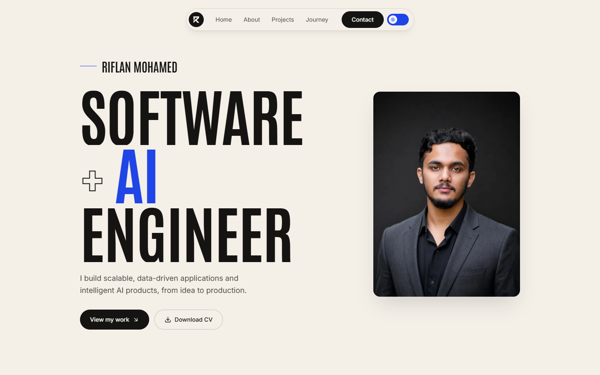

<div align="center">

# Riflan Mohamed — Portfolio

**Software Engineer & AI Developer** · Full-stack · Real-time systems

[](https://rizlan.me)
&nbsp;

&nbsp;

&nbsp;


<br/>



</div>

---

## Overview

My personal portfolio — a fast, animated, fully responsive single-page site that showcases my work in full-stack engineering and applied AI. Built from scratch with React 19 + TypeScript + Vite and Tailwind CSS v4, with motion handled by the `framer-motion` library and buttery scrolling via Lenis.

**Live:** [rizlan.me](https://rizlan.me)

## ✨ Features

- **Editorial hero** — my portrait between oversized condensed type, with a playful "Hi" badge.
- **Services, about and journey** sections with count-up stats, an interactive service list and my experience and education.
- **Stacking featured-project cards** that pin as you scroll, plus an expandable list of every project.
- **Certifications bento grid** with a full-size certificate viewer.
- **"How I build" process grid**, FAQ accordion and a contact form that opens your email app with the message ready.
- **Light / dark theme** (indigo / lime) with a film-grain dark mode, respecting system preference.
- **Fully responsive** from 320px phones to large desktops, with smooth scrolling (Lenis) and reduced-motion support.

## 🛠️ Tech Stack

| Area | Tools |
|---|---|
| **Core** | React 19, TypeScript, Vite |
| **Styling** | Tailwind CSS v4, shadcn-style components, `class-variance-authority` |
| **Animation** | framer-motion, Lenis (smooth scroll) |
| **UI / Icons** | Lucide, Devicon, custom brand icons |
| **Tooling** | ESLint, TypeScript strict mode |

## 🚀 Getting Started

> Requires **Node.js 20+**.

```bash
# clone
git clone https://github.com/RizAhd/Portfolio-Updated.git
cd Portfolio-Updated

# install
npm install

# run the dev server (http://localhost:5173)
npm run dev

# production build
npm run build

# preview the production build
npm run preview
```

## 📁 Project Structure

```
src/
├── App.tsx                  # Page composition
├── data/portfolio.ts        # All content (profile, projects, skills, …)
├── hooks/                   # theme, smooth-scroll, screen-size, parallax
├── components/
│   ├── navbar.tsx
│   ├── sections/            # hero-adjacent sections: about, projects, quote,
│   │                        #   skills, resume, education, ask-me, contact
│   └── ui/                  # reusable animated components & primitives
└── index.css                # theme tokens (light/dark) + global styles
```

## 🌐 Deployment

Deployed to **GitHub Pages** via GitHub Actions (`.github/workflows/deploy.yml`) on every push to `main`, served from the custom domain **rizlan.me** (see `public/CNAME`).

## 📫 Connect

- 🌐 Portfolio — [rizlan.me](https://rizlan.me)
- 💼 LinkedIn — [linkedin.com/in/riflan](https://www.linkedin.com/in/riflan/)
- 🐙 GitHub — [github.com/RizAhd](https://github.com/RizAhd)
- ✉️ Email — rizlanahmd4545@gmail.com

---

<div align="center">

Built by **Riflan Mohamed**. © 2026

</div>
